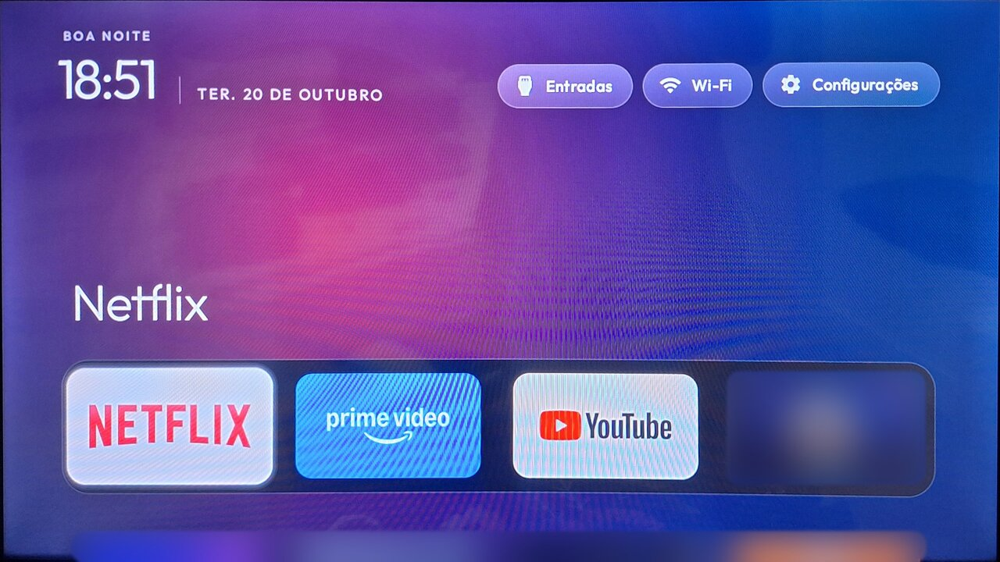
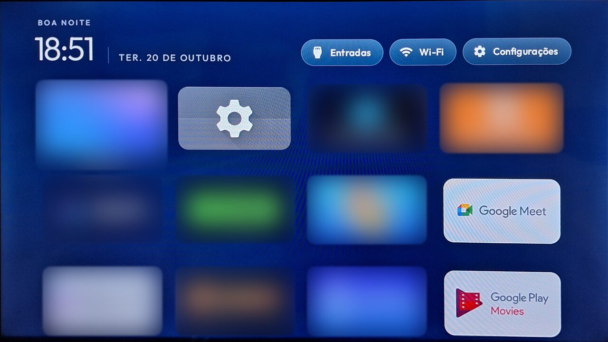
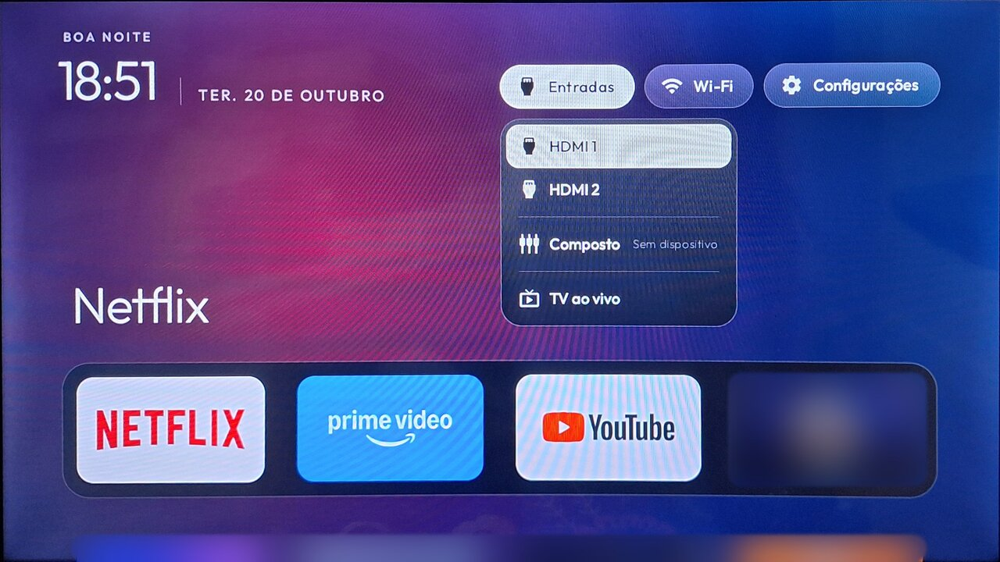
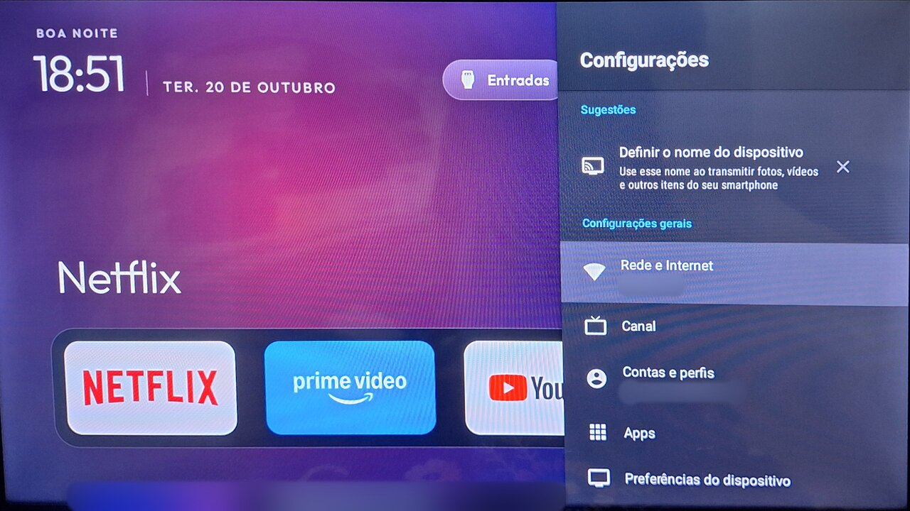

# ATV Leve

Deixa **TVs Android TV / Google TV com pouca memória** mais rápidas, desativando apps
que vêm de fábrica e não são usados, e ajustando as animações. Funciona **pelo Wi-Fi,
via ADB, sem root**.

Feito pensando nas TVs baratas vendidas no Brasil (Aiwa, Philco, Multilaser, Semp,
TCL, etc.) com 1 a 2 GB de RAM.

- **Diagnostica antes de agir**: mostra RAM, armazenamento e quais apps pesam mais.
- **Simula antes de fazer**: `atvleve plan` mostra tudo o que seria feito, sem mexer em nada.
- **Sempre reversível**: faz backup automático e desfaz tudo com `atvleve restore`.
- **Nunca toca no que é essencial**: tela inicial, Play Store, configurações, controle
  remoto, Wi-Fi, entradas HDMI e serviços do Google ficam protegidos.
- **Perfis por modelo de TV**, feitos pela comunidade com dados de TVs reais.
- Sem internet, sem coleta de dados, sem downloads escondidos. Só conversa com a sua TV
  pela rede local.

---

## Como fica na TV

Uma Aiwa (Android 14, 913 MB de RAM) depois de trocar a tela inicial pelo launcher leve
do [Clean Your TV](https://github.com/Gathin23/cleanyourtv) e aplicar uma cor de fundo
com `atvleve theme`. Parada na tela inicial, a memória livre passou de ~238 MB para
~330 MB. Os apps que não vêm de fábrica foram borrados.

| Tela inicial | Todos os apps |
|---|---|
|  |  |
| **Botão Entradas (HDMI, TV ao vivo)** | **Configurações rápidas** |
|  |  |

---

## ⚠️ Leia antes de usar

- Você usa por sua conta e risco. O ATV Leve foi feito para ser cuidadoso, mas cada TV é
  diferente.
- O padrão é **desativar** apps (eles continuam na TV e voltam com um comando).
  Desinstalar só acontece se você usar `--uninstall` de propósito.
- Antes de qualquer mudança, o ATV Leve **grava um backup** no seu computador. Se não
  conseguir gravar, ele não faz nada.
- As mudanças são feitas **de 5 em 5**. Depois de cada lote o ATV Leve confere se a TV
  ainda tem tela inicial; se algo sumir, ele **desfaz o lote sozinho** e para.
- **Plano B**: se tudo der errado, o **reset de fábrica** da TV (Configurações → Sistema →
  Sobre → Redefinir) traz todos os apps de volta. Você perde os logins e apps instalados,
  mas a TV volta a ser como saiu da caixa.

---

## Antes de tudo: ative o ADB na TV

1. Na TV: **Configurações → Sistema** (ou *Preferências do dispositivo*) **→ Sobre**.
2. Aperte **OK 7 vezes** em **Build do Android TV OS** até aparecer
   "Você agora é um desenvolvedor".
3. Volte e abra **Opções do desenvolvedor**.
4. Ative **Depuração USB** e, se existir, **Depuração pela rede** / **Depuração por ADB**.
5. Veja o **IP da TV** em Configurações → Rede e Internet → (sua rede Wi-Fi).
   Exemplo: `192.168.0.20`.

O computador e a TV precisam estar **na mesma rede**.

Agora escolha **um** dos dois jeitos de rodar o ATV Leve:

| | [Opção A: Docker](#opção-a-com-docker) | [Opção B: instalação local](#opção-b-instalação-local) |
|---|---|---|
| Precisa instalar | Só o Docker | Python e adb |
| Indicado para | Quem quer só usar | Quem vai mexer no código ou não tem Docker |
| Comando | `docker compose run --rm atvleve ...` | `atvleve ...` |

---

## Opção A: com Docker

Python, adb e o painel já vêm dentro da imagem. Você só precisa do
[Docker](https://docs.docker.com/get-docker/) (no Windows e no macOS, o Docker Desktop).

### Instalar e subir o painel

```bash
git clone https://github.com/SEU_USUARIO/atv-leve.git
cd atv-leve
docker compose up -d --build
```

Abra **http://localhost:8765** no navegador, digite o IP da TV e clique em **Analisar**.
Na primeira conexão a TV pergunta se permite a depuração: marque "Sempre permitir" e
confirme.

### Linha de comando

Todos os comandos do [Como usar](#como-usar) funcionam no Docker. É só trocar `atvleve`
por `docker compose run --rm atvleve`:

```bash
docker compose run --rm atvleve doctor --ip 192.168.0.20
docker compose run --rm atvleve plan   --ip 192.168.0.20
docker compose run --rm atvleve apply  --ip 192.168.0.20
```

### Parar, voltar a usar e atualizar

```bash
docker compose down             # para o painel
docker compose up -d            # sobe de novo
git pull && docker compose up -d --build   # atualiza para a versão mais nova
```

### Onde ficam as coisas

- **Backups**: na pasta `backups/` do projeto, no seu computador. Dentro do container
  ela aparece como `/dados/backups` (use esse caminho em `restore --file`).
- **Chave do adb**: num volume do Docker, então a TV não pede autorização de novo.
  `docker compose down -v` apaga essa chave (a TV vai perguntar outra vez).
- **Arquivos que você gera** (como o `profile-export`): grave em `/dados/backups` para
  eles aparecerem na pasta `backups/`, por exemplo
  `docker compose run --rm atvleve profile-export --ip 192.168.0.20 -o /dados/backups/perfil.yaml`.
- **Painel**: só abre neste computador (`127.0.0.1`). Não publique a porta para a rede:
  ele não tem senha e pode alterar a TV.

### Problemas comuns no Docker

- **`address already in use` na porta 8765**: já tem outro painel rodando (por exemplo
  o da instalação local). Feche-o, ou mude a porta no `compose.yaml` para
  `"127.0.0.1:8766:8765"` e abra http://localhost:8766.
- **Erro de permissão ao gravar o backup (Linux)**: se o seu Docker é *rootless*
  (o `docker info` mostra `rootless`), crie um arquivo `.env` na pasta do projeto com a
  linha abaixo; no rootless o usuário 0 do container é o seu próprio usuário.

  ```bash
  echo "ATVLEVE_USER=0:0" >> .env
  ```

  Com o Docker normal, rode `sudo chown 1000:1000 backups`.
- **Instalar um APK com `launcher --install`**: coloque o arquivo em `backups/` e use o
  caminho de dentro do container:
  `docker compose run --rm atvleve launcher --ip 192.168.0.20 --install /dados/backups/app.apk`.

---

## Opção B: instalação local

### 1. Instale o Python e o adb no computador

- **Python 3.10 ou mais novo**: https://www.python.org/downloads/ (no Windows, marque
  "Add Python to PATH" na instalação).
- **adb** (Android platform-tools):
  - Linux (Debian/Ubuntu): `sudo apt install adb`
  - Linux (Fedora): `sudo dnf install android-tools`
  - macOS: `brew install android-platform-tools`
  - Windows: baixe o "SDK Platform-Tools for Windows" em
    https://developer.android.com/tools/releases/platform-tools, descompacte em
    `C:\platform-tools` e adicione essa pasta ao PATH.

### 2. Baixe e instale o ATV Leve

```bash
git clone https://github.com/SEU_USUARIO/atv-leve.git
cd atv-leve
python -m venv .venv
# Linux/macOS:
source .venv/bin/activate
# Windows:
.venv\Scripts\activate
pip install -e ".[web]"
```

> Instale com `pip install -e` a partir da pasta clonada: assim o ATV Leve encontra os
> perfis (`profiles/`) e guarda os backups em `backups/`, dentro da própria pasta.
> O `[web]` instala o painel; sem ele você fica só com a linha de comando.

### 3. Suba o painel (opcional)

```bash
atvleve web
```

Abra http://127.0.0.1:8765. Por padrão o painel só abre neste computador;
`--host 0.0.0.0` libera para a rede **sem senha**, e qualquer pessoa da rede poderia
alterar a TV. Evite.

---

## Como usar

Os exemplos usam `atvleve`. **No Docker**, escreva `docker compose run --rm atvleve` no
lugar.

### 1. Conecte

```bash
atvleve doctor --ip 192.168.0.20
```

Na primeira vez a TV mostra **"Permitir depuração?"**: marque *Sempre permitir deste
computador* e confirme.

**Se a sua TV só tem "Depuração sem fio" (Wireless debugging)**, comum no Google TV 14:

1. Na TV, abra *Depuração sem fio → Parear dispositivo com código*.
2. `atvleve doctor --pair IP:PORTA_DE_PAREAMENTO --code CODIGO`
3. Depois `atvleve doctor --ip IP:PORTA` com a porta mostrada na tela principal de
   *Depuração sem fio* (ela é diferente da porta de pareamento).

### 2. Veja como a TV está

```bash
atvleve info --ip 192.168.0.20     # modelo, Android, RAM, espaço livre
atvleve top  --ip 192.168.0.20     # apps que mais usam memória
atvleve scan --ip 192.168.0.20     # todos os apps e a classificação de cada um
```

Dica: para não repetir o IP, defina a variável `ATVLEVE_IP=192.168.0.20`. No Docker,
coloque essa linha no arquivo `.env` da pasta do projeto.

### Prefere o navegador? Use o painel

Abra o painel em http://localhost:8765 (no Docker ele já está rodando; na instalação
local, rode `atvleve web`), digite o IP e a porta da TV e clique em **Analisar**. O painel
mostra RAM, armazenamento, os apps que mais pesam e o que dá para melhorar.

Para aplicar, clique em **Revisar e aplicar**: os apps `seguro` vêm marcados, os
`confirmar` vêm desmarcados (marque só o que você não usa), e você confirma antes. O
painel faz o mesmo que o `atvleve apply`: backup antes, lotes pequenos com checagem da
tela inicial e reversão automática. No final aparece o botão **Desfazer**.

### 3. Simule

```bash
atvleve plan --ip 192.168.0.20
```

Nada é alterado. Você vê o que seria desativado e quais ajustes seriam feitos.

### 4. Aplique

```bash
atvleve apply --ip 192.168.0.20
```

O ATV Leve pergunta sobre cada app duvidoso, mostra o plano final, pede confirmação,
grava o backup e executa. No final, **reinicie a TV** e teste: tela inicial, controle
remoto, HDMI, Wi-Fi e os apps que você usa.

### 4b. Opcional: troque a tela inicial

Nas TVs com pouca RAM a tela inicial original costuma ser o app que mais pesa (na
Aiwa testada, ~110 MB) e é de onde vêm os anúncios. Instale o **FLauncher** pela Play
Store da TV (se ele não aparecer, use o **Projectivy Launcher**), abra uma vez e rode:

```bash
atvleve launcher --ip 192.168.0.20                              # mostra as opções
atvleve launcher --ip 192.168.0.20 --set me.efesser.flauncher   # troca
```

O ATV Leve define o FLauncher como padrão e confere; só então **desativa** (não
desinstala) o assistente de configuração e a tela original, conferindo o Home a cada
passo. Se o Home sair do FLauncher, tudo volta sozinho. `atvleve restore` reativa a tela
original e devolve o padrão para ela. Mais detalhes em
[docs/launcher-leve.md](docs/launcher-leve.md).

### 5. Se algo der errado

```bash
atvleve restore --ip 192.168.0.20         # desfaz a última alteração
atvleve restore --ip 192.168.0.20 --all   # desfaz todas as alterações do ATV Leve nesta TV
atvleve restore --list                    # lista os backups
atvleve restore --file backups/.../2026-10-20_140716.json --ip 192.168.0.20
```

---

## Como o ATV Leve decide o que mexer

Cada app recebe uma classificação:

| Classificação | O que acontece |
|---|---|
| `protegido` | **Nunca** entra no plano, nem se você pedir. Inclui a tela inicial atual (só o `atvleve launcher` mexe nela, com as próprias checagens). |
| `seguro` | Entra no plano. Foi testado por alguém em uma TV igual à sua. |
| `confirmar` | O perfil acha que pode ser desativado, mas o `apply` pergunta um por um. |
| `desconhecido` | Fica de fora. Só entra se você pedir pelo nome com `--include` (e confirmar). |

As regras de proteção comuns a todas as TVs estão em
[`profiles/_generic.yaml`](profiles/_generic.yaml). As listas de cada modelo ficam em
`profiles/<marca-modelo>.yaml`.

> **Se não existe perfil para a sua TV, o ATV Leve não desativa nada sozinho.** É de
> propósito: listas de apps só entram no projeto depois de testadas em TV real. Você
> ainda pode usar `tune` (animações) e escolher apps com `--include`.

## Todos os comandos

| Comando | O que faz |
|---|---|
| `atvleve doctor` | Verifica adb, conexão e autorização; explica como ativar o ADB |
| `atvleve info` | Marca, modelo, Android, RAM, espaço livre, tela inicial |
| `atvleve scan` | Lista os apps e a classificação de cada um (`--only seguro`, etc.) |
| `atvleve top` | Apps que mais consomem memória |
| `atvleve backup` | Salva o estado atual |
| `atvleve plan` | Mostra o que seria feito, **sem alterar nada** |
| `atvleve apply` | Backup automático + execução com confirmação e checagem de segurança |
| `atvleve tune` | Só as animações (`--scale 0`, `0.5` ou `1`; padrão `0.5`) |
| `atvleve launcher` | Mostra a tela inicial; `--set PACOTE` troca por um launcher leve |
| `atvleve restore` | Desfaz a última alteração (`--all`, `--file`, `--list`) |
| `atvleve profile-export` | Gera um perfil-modelo da sua TV para contribuir |
| `atvleve web` | Abre o painel no navegador (analisar, aplicar e desfazer) |

Opções comuns: `--ip`, `--serial`, `--profile`, `--yes` (não pergunta nada; os apps
`confirmar` ficam de fora), `--verbose` (mostra cada comando adb).
Só no `plan`/`apply`: `--uninstall`, `--include PACOTE`, `--no-tune`, `--scale`,
`--batch-size`.

### Sobre `--uninstall`

Remove o app para o usuário da TV (`pm uninstall -k --user 0`), liberando um pouco mais
de espaço. Ele pode voltar com `atvleve restore`, mas volta **na versão de fábrica**:
as atualizações da Play Store se perdem e o app vai se atualizar de novo. Na dúvida,
fique com o padrão (desativar).

### Sobre os ajustes de desempenho

O `tune` (e o `apply`, a menos que você use `--no-tune`) muda as três escalas de
animação do Android para 0.5. Os menus ficam mais rápidos e o processador trabalha
menos. Os valores originais vão para o backup. Não há ajustes experimentais ativos
nesta versão.

## Contribua com o perfil da sua TV

1. Rode `atvleve profile-export --ip IP_DA_TV`. Isso gera `perfil-marca-modelo.yaml` com
   a lista de apps da sua TV (sem número de série nem dados pessoais).
2. Teste: desative um app de cada vez com `atvleve apply --include NOME`, reinicie,
   use a TV por um tempo.
3. Mova para `safe_to_disable` só o que você testou de verdade.
4. Abra um pull request. Detalhes em [docs/adicionar-perfil.md](docs/adicionar-perfil.md).

## Para desenvolvedores

```bash
pip install -e ".[dev]"
pytest          # não precisa de TV: os testes usam uma TV simulada
ruff check .
```

- Todo contato com o adb passa por `AdbRunner` (`src/atvleve/adb.py`). Os testes trocam
  só o método `_exec` por uma TV simulada (`tests/fake_tv.py`).
- Qualquer mudança em `profiles/_generic.yaml` precisa vir com teste em
  `tests/test_protection.py`.
- Variáveis de ambiente: `ATVLEVE_IP`, `ATVLEVE_PROFILES` (pasta de perfis) e
  `ATVLEVE_HOME` (onde ficam os backups).

Licença: MIT.
